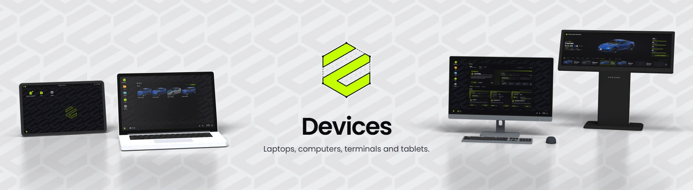

<h1 align="center">Evolent Devices</h1>

Laptops, computers, terminals and tablets that run a single operating system and include an App Store. Works on Qbox, QBCore, and ESX.

Admins set up the device in public areas (i.e. on tables/counters). Players purchase their own devices and secure them with a password. Third-party scripts running on the server can install their own apps on them. When someone uses the device, everyone else around them can view what is displayed on the screen.

## What it's for

A laptop sitting on a desk is just a prop, until a script provides the screen. Many scripts requiring a screen create either a tablet or menu, which allows each of the various jobs, shops, and missions to have their own unique appearance and rules as to who can use them. Evolent Devices gives them one OS. A script only has to register its app once, and the devices decide where it shows and who may open it.

- **Businesses and jobs.** A police records computer, a shop register, a dealership kiosk or a desk computer only staff can open.
- **Players' own devices.** Laptops, computers and tablets as inventory items, placed at home and locked with a password.
- **Missions and heists.** A script spawns a laptop for one player, with its own app on it, and removes it when the job is done.
- **Notifications.** Apps reach a player wherever they are: at a device, on the tablet or as a card in the game.

## The devices

<table>
  <tr>
    <td width="50%">
      <picture>
        <source media="(prefers-color-scheme: dark)" srcset=".github/assets/spin-laptop-dark.webp">
        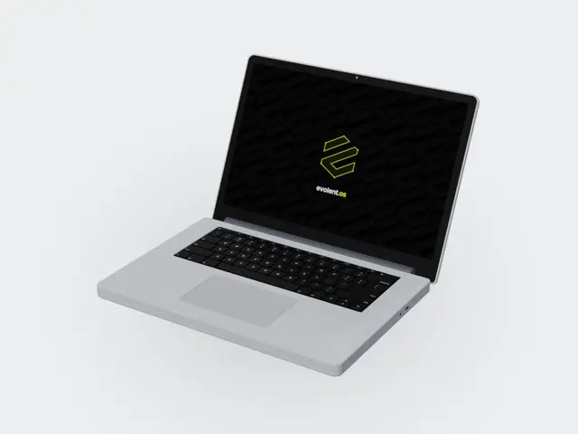
      </picture>
    </td>
    <td width="50%">
      <picture>
        <source media="(prefers-color-scheme: dark)" srcset=".github/assets/spin-pc-dark.webp">
        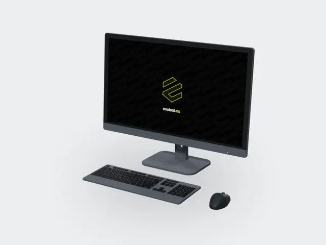
      </picture>
    </td>
  </tr>
  <tr>
    <td align="center"><b>Laptop</b><br><sub>Put on a table by a player, or placed by an admin.</sub></td>
    <td align="center"><b>Computer</b><br><sub>A desk computer with a keyboard and mouse.</sub></td>
  </tr>
  <tr>
    <td width="50%">
      <picture>
        <source media="(prefers-color-scheme: dark)" srcset=".github/assets/spin-terminal-dark.webp">
        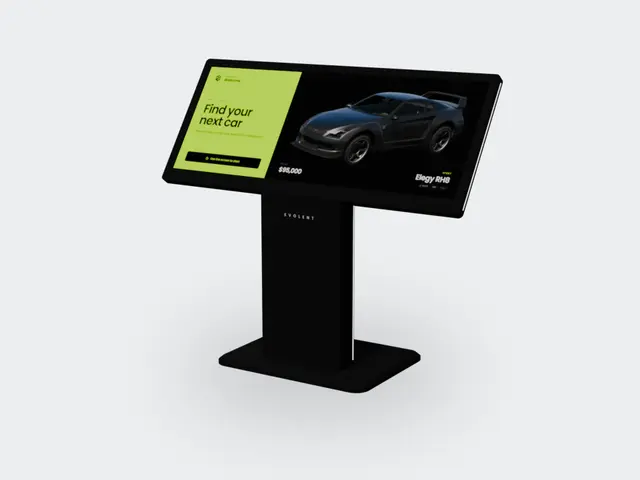
      </picture>
    </td>
    <td width="50%">
      <picture>
        <source media="(prefers-color-scheme: dark)" srcset=".github/assets/spin-tablet-dark.webp">
        
      </picture>
    </td>
  </tr>
  <tr>
    <td align="center"><b>Terminal</b><br><sub>A wide kiosk screen that runs one app.</sub></td>
    <td align="center"><b>Tablet</b><br><sub>Taken out of the inventory and held in the hands.</sub></td>
  </tr>
</table>

## Features

### The Evolent OS

Laptops and computers run a desktop with windows, a taskbar, a launcher and a notification centre.

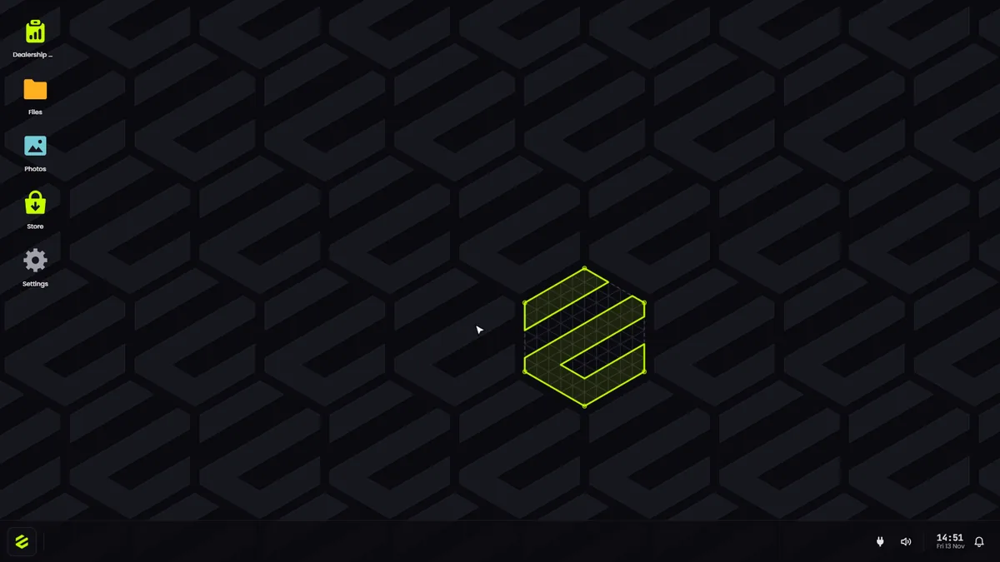

- **Store**: players install the apps the server allows on that device.
- **Notes**, **Files** and **Photos**, kept on the device for the next person who uses it.
- **Settings**: a password, the volume, the wallpaper, do not disturb and pop-ups per app.
- **People nearby** see the screen of a device in use, with the pointer moving on it.
- **Signal**: laptops and tablets need an antenna, computers and terminals are wired.
- **One app mode** for a register or a kiosk: no desktop, just the app.

### The tablet

The tablet opens the same apps full screen in the player's hands, with the light of the screen on their face. Other players see them looking down at it. It goes away by itself when they get into a vehicle, swim, fall or get cuffed.

<table>
  <tr>
    <td width="50%">
      <picture>
        <source media="(prefers-color-scheme: dark)" srcset=".github/assets/tablet-hands-dark.webp">
        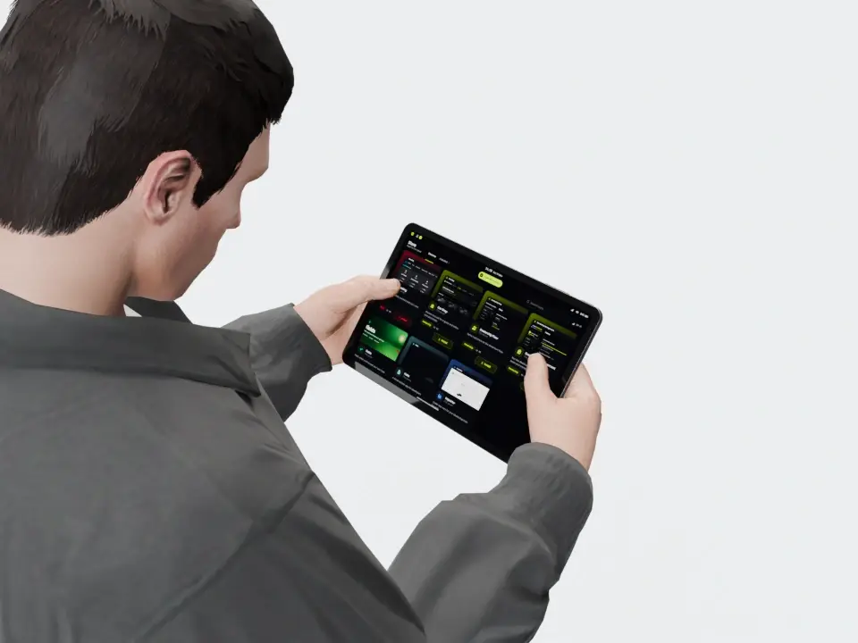
      </picture>
    </td>
    <td width="50%">
      <picture>
        <source media="(prefers-color-scheme: dark)" srcset=".github/assets/tablet-colours-dark.webp">
        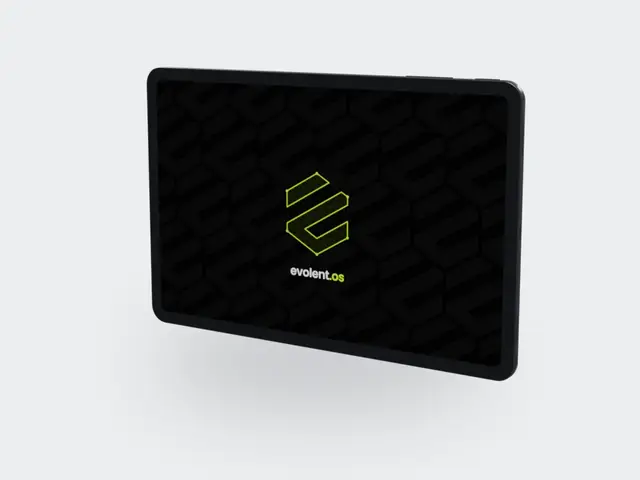
      </picture>
    </td>
  </tr>
  <tr>
    <td align="center">Used with both hands</td>
    <td align="center">Ten colours to sell in shops</td>
  </tr>
</table>

### Notifications

A notification reaches the player wherever they are: as a banner at a device, as a card in the corner of the game screen, or on the tablet in their pocket. Their own laptop at home shows the count on its screen.

<table>
  <tr>
    <td width="50%"></td>
    <td width="50%">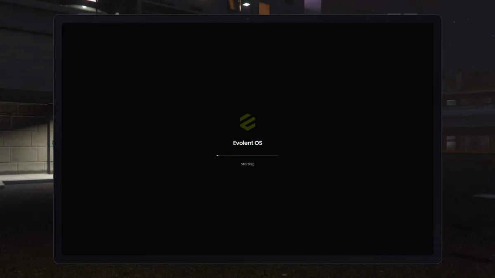</td>
  </tr>
  <tr>
    <td align="center">Cards in the corner of the game screen</td>
    <td align="center">Waiting on the tablet's lock screen</td>
  </tr>
</table>

### The admin panel

`/evdevices` opens the panel. Every change is saved at once and written to an activity log.

- **Place devices** with a free camera that snaps to tables.
- **Decide who may use each device**: everyone, the owner, or rules by citizen, job and grade, gang or the keys of a home.
- **Choose the apps** on each device, and allow new apps from other scripts.
- **Map and signal**: every device on a map, antennas, and zones where players may not place devices.
- **Brand**: one colour, logo, name and wallpaper for the panel, the OS, the tablet and the idle screens.

<table>
  <tr>
    <td width="33%">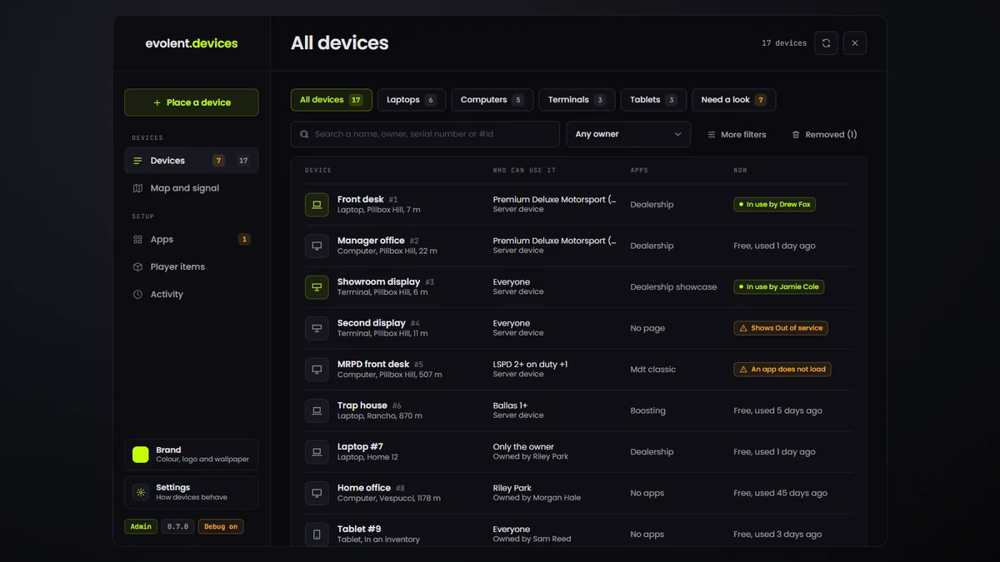</td>
    <td width="33%">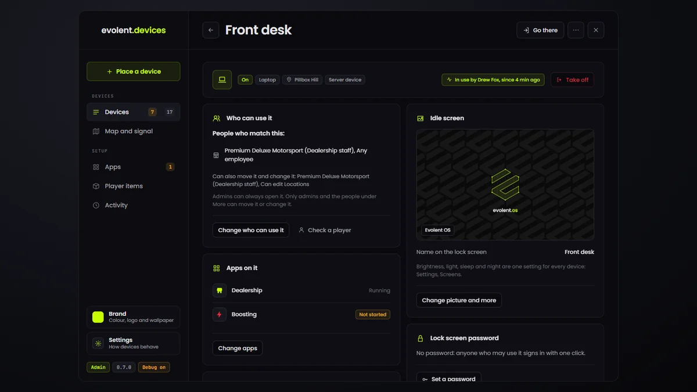</td>
    <td width="33%">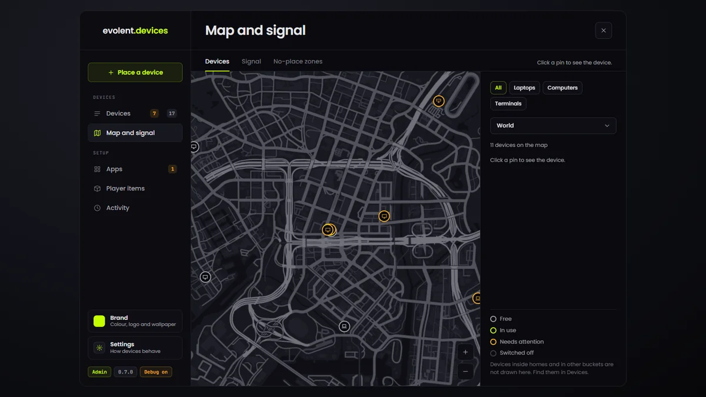</td>
  </tr>
  <tr>
    <td align="center">Every device on the server</td>
    <td align="center">Who may use it and which apps it shows</td>
    <td align="center">Devices and antennas on the map</td>
  </tr>
  <tr>
    <td width="33%">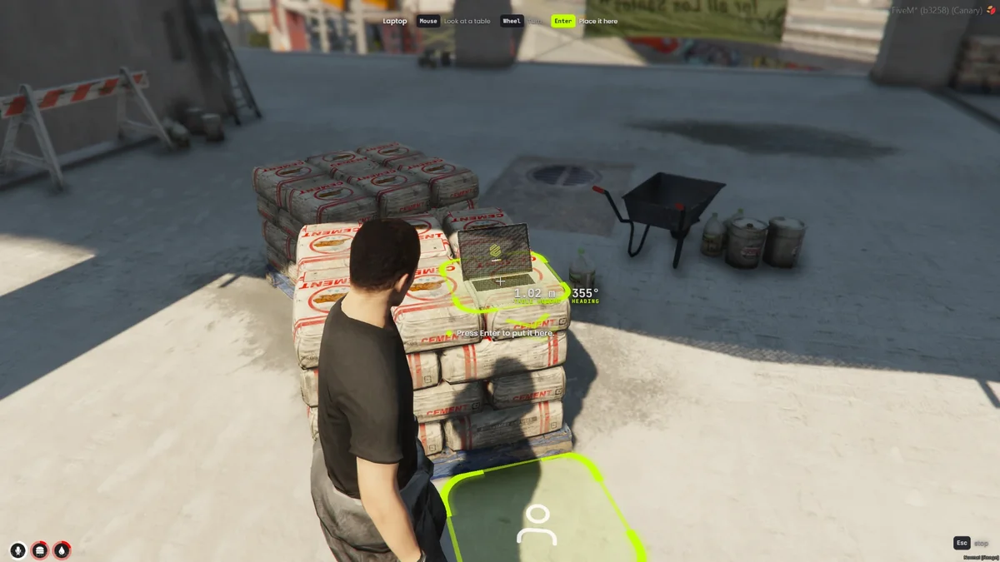</td>
    <td width="33%">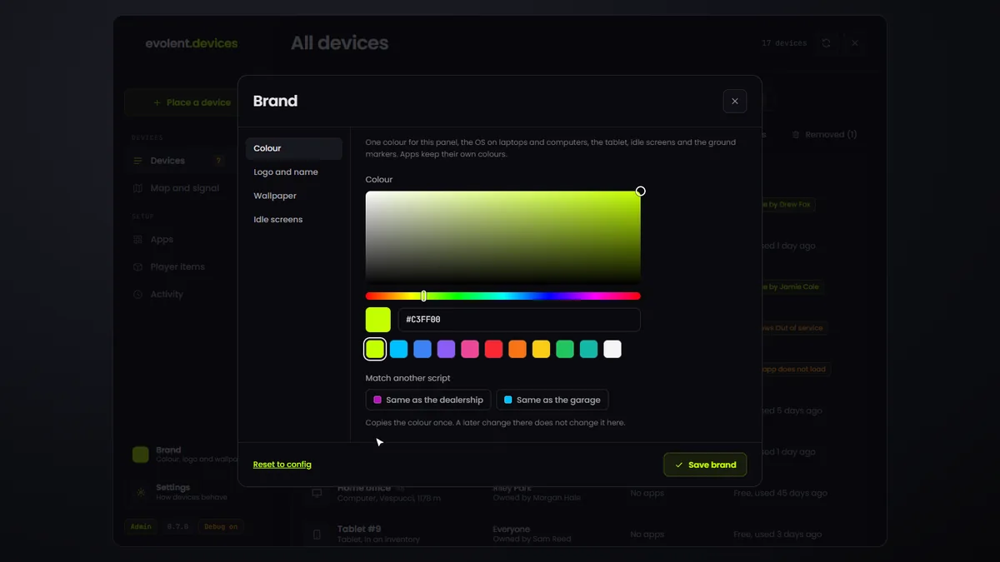</td>
    <td width="33%">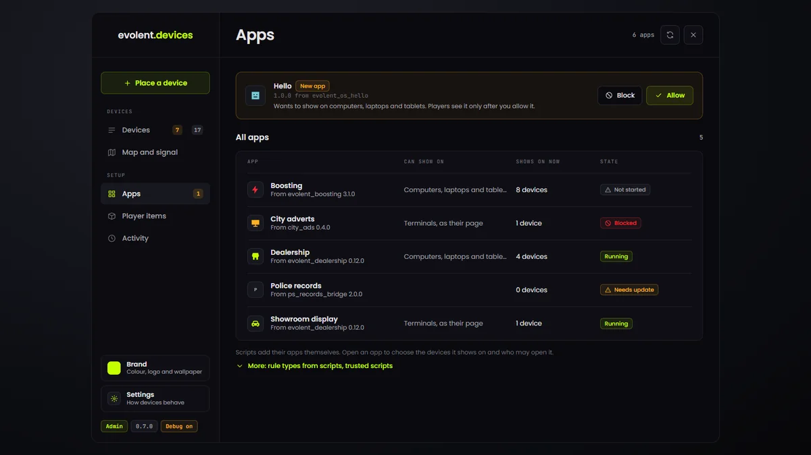</td>
  </tr>
  <tr>
    <td align="center">Putting a laptop on a table</td>
    <td align="center">One colour for everything</td>
    <td align="center">Apps from other scripts</td>
  </tr>
</table>

### Apps for your scripts

Any resource can put its own web page into the OS. Evolent Devices handles the device, the camera, the windows, the password and what people nearby see.

Your page uses the SDK from npm, [`@evolent/os-app`](https://www.npmjs.com/package/@evolent/os-app):

```ts
import { connectApp } from '@evolent/os-app';

const os = connectApp();
const reply = await os.post('roll');
```

Your client answers the page with one function per call:

```lua
local OsApp = require '@evolent_devices.sdk.app'

OsApp.handle('hello', 'roll', function(data)
    return lib.callback.await('hello:roll', false)
end)
```

And your server registers the app:

```lua
exports.evolent_devices:registerApp({
    api = 1,
    id = 'hello',
    label = 'Hello',
    version = '1.0.0',
    icon = { path = 'M4 4h16v16H4z', color = '#C3FF00' },
    page = 'web/build/index.html',
    kinds = { 'pc', 'laptop', 'tablet' },
    canvas = { width = 960, height = 600 },
})
```

Scripts can also send notifications, spawn devices for a mission, lend the tablet and add their own access rules. Start from the example app, [evolent_os_hello](https://github.com/evolent-labs/evolent_devices_example_app).

## Installation

### Requirements

- [ox_lib](https://github.com/CommunityOx/ox_lib) and [oxmysql](https://github.com/CommunityOx/oxmysql)
- OneSync
- [Qbox](https://github.com/Qbox-project/qbx_core), [QBCore](https://github.com/qbcore-framework/qb-core) or [ESX](https://github.com/esx-framework/esx_core) (Legacy 1.10 or later)
- ox_inventory, qb-inventory 2.x or the ESX inventory, for the player items
- [ox_target](https://github.com/CommunityOx/ox_target) is optional. Without it, players use devices with a key prompt.

### Quick start

1. Download the latest version from [Releases](https://github.com/evolent-labs/evolent_devices/releases/latest) and put it in your `resources` folder. The release includes the built UI. A clone of the repository does not: build it with `npm install` and `npm run build` in `web`.
2. Add the laptop, computer and tablet items to your inventory. The lines are in the [documentation](https://docs.evolent.dev/devices#add-the-items).
3. Add this to your `server.cfg`, after `ox_lib`, `oxmysql`, your framework and your inventory:

   ```cfg
   add_ace group.admin evolent_devices.admin allow
   ensure evolent_devices
   ```

4. Start the server. The database tables are created on the first start.
5. Type `/evdevices` in game and press **Place a device**.

The resource streams its models, so restart it only with nobody on the server.

## Documentation

Everything is at [docs.evolent.dev/devices](https://docs.evolent.dev/devices):

- [Getting started](https://docs.evolent.dev/devices): installation, the item lines and updating
- [Configuration](https://docs.evolent.dev/devices/Config): every option in `config/settings.lua`
- [The panel](https://docs.evolent.dev/devices/Panel) and [using devices](https://docs.evolent.dev/devices/Usage)
- [Building apps](https://docs.evolent.dev/devices/Apps) and the [exports](https://docs.evolent.dev/devices/Exports)

English, Spanish, French and Portuguese (Brazil) are included, through ox_lib locales.

## Development

`web/` is Svelte 5, TypeScript and Vite, built into `web/build`, the only part of `web/` the server needs. In `web`: `npm install` once, `npm run check` for the type check, `npm run build` to write `web/build`, `npm run build:sdk` for `sdk/dist`, and `npm run dev` for a browser preview with sample data.

## Discord

Join our [Discord](https://discord.gg/aA57M62Nw7) for support or to share feedback.

## License

Evolent Devices is licensed under GPL-3.0: use it, change it and share it, and keep what you share under the same licence. See [LICENSE](LICENSE).

The app SDK in `sdk/`, with the Lua helper `sdk/app.lua`, is MIT licensed (`sdk/LICENSE`), so an app built with it can carry any licence, paid or closed. The fonts in `web/public/fonts` are under the SIL Open Font License.
